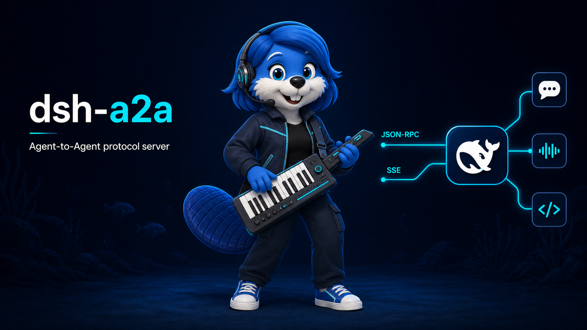

# @amaster.ai/dsh-a2a



A2A protocol server plugin for [DeepSeek Harness (dsh)](https://github.com/deepseek-ai/deepseek-harness): expose dsh agents as [A2A](https://github.com/a2aproject) agents — streaming turns, task cancel, agent card, and pluggable task-state stores. Speaks **A2A 1.0** (JSON-RPC + SSE) on [`@a2a-js/sdk`](https://github.com/a2aproject/a2a-js) 1.x, with the SDK's opt-in **v0.3 compatibility layer** kept on so pre-1.0 clients keep working. Ported from the source project's `packages/a2a-server`.

`dsh-a2a` is the network boundary for a dsh agent. It gives A2A clients a stable task-oriented interface while the agent continues to use the profile's models, presets, tools, and workspace rules.

## Install

```sh
dsh plugin --profile my-agent add @amaster.ai/dsh-a2a
```

## Native inbox execution

`inbox.enabled: true` uses the official DSH inbox (`Agent.send`) for ordinary `next-turn` input and `next-step` steering. Tested with the unmodified npm runtime `0.2.1-rc.2`; no core patch is required. The queue and its durable projection belong to DSH. The plugin only materializes messages, attaches A2A task identities, and translates execution events.

Standard `SendMessage` / `SendStreamingMessage`, task queries, cancellation and subscriptions remain the wire interface. The negotiated [inbox extension](../../docs/protocol/inbox-v1.md) forwards `target` and `wakeup` to DSH. `wakeup: false` leaves an idle driver parked; it does not prevent an active driver from consuming pending input. A later real waking message releases pending input.

The same-process `a2aInbox` service exposes `resolve(contextId)`, `content(message, contextId)`, `enqueue(taskId, message, { target?, wakeup? })`, `promote(contextId, nativeMessageId, activeTaskId)`, and `cancel(taskId)`. There is no separate pause, wake-only, resume, or retained-task restart operation. Cancellation is terminal and removes that task's pending input. Other tasks' input is retained according to official DSH cancellation semantics, and may wait for the next waking message. Clearing a context discards all its pending work.

`a2a/before-followup` validates admission; `a2a/before-step` runs at the official pre-step boundary, after system-prompt assembly and before model execution. It cannot change the already assembled system prompt. Original request headers remain process-local. DSH persistence restores its own pending projection; the plugin does not replay splice logs or recover consumed claims. Graceful disposal cancels tasks by default; `inbox.shutdown: retain-pending` opts into the retention policy below. Durable A2A task snapshots require a filesystem, Redis or GCS TaskStore; an in-memory store is sufficient without restart requirements.

### Goal rounds

When the optional official `@deepseek-ai/dsh-goal` and `dsh-goal-round-driver` plugins are mounted, a Goal created or resumed during an A2A task keeps that task open while the Goal is active and armed. Automatic rounds retain the driver's original native message ID, content and `goal` source. The official driver still validates its reservation, revision and round; the plugin selects the owning task for streaming and `a2a/before-step` billing attribution. Editing the same Goal from another task preserves its original owner. Completing, pausing, blocking or disarming the Goal releases that ownership. A cold restart does not inherit automatic Goal authority: the host must explicitly resume it through a live attributed task.

### Promote a queued input

Queue an ordinary future turn as a new task (omit `taskId`). To steer an active task with that already admitted input, pass its **native DSH message ID**, available from `agent.inbox.nextTurn` or `a2a/inbox` observations:

```ts
await ctx.a2aInbox.promote(contextId, nativeMessageId, activeTaskId);
```

Only an unclaimed, single-message independent task in the same context can be promoted. The native ID and A2A `messageId` stay unchanged; the target task owns the next-step input, and `referenceTaskIds` records the original task, which settles canceled after the durable transfer. Claimed input, a finished target, concurrent consumption or task settlement reject a stale request. A failed session checkpoint restores independent ownership; a later storage error can report failure after the transfer committed: inspect the queue and task states before sending new input. Recovery repairs interrupted transfers without replaying an ordinary DSH claim or committed model input.

### Local restart recovery

Select `taskStore: filesystem` with `filesystem.root` pointing at a retained directory, and separately enable durable DSH session persistence. Keep queued file materialization on retained storage as well. Each task snapshot is scoped by tenant and user, written to a private temporary file and atomically renamed; no additional service is needed. Use one host writer per directory. Files have no automatic expiry; context clearing deletes task snapshots.

After a crash, the host discovers sessions, calls `a2aInbox.resolve(contextId)` and supplies a real attributed waking input through the normal API. Restored unclaimed inputs keep their original task ownership. Startup scanning and scheduling remain host responsibilities. Explicit cancellation stays terminal and discards only the canceled task's input. This does not promise exactly-once external side effects, replay of consumed input, or replay of the interrupted active model call.

### Graceful host shutdown

Set `inbox: { enabled: true, shutdown: retain-pending }` on both sides of a restart to retain unclaimed A2A `next-step` and `next-turn` input. Keep durable session persistence, the TaskStore and materialized files on retained storage. This is a host configuration policy, not wire metadata. The default `shutdown: cancel` keeps the existing terminal-on-unload behavior.

Retention stops the current execution, checkpoints pending input in task snapshot metadata with its order and original native/A2A identities, then closes live request/subscription streams. The extra checkpoint survives the core's later inbox-clearing disposal. A task with pending input stays nonterminal for recovery; an interrupted task with no pending input becomes failed. Reconnect subscriptions after restart: streams are not replayed or carried across processes.

On `a2aInbox.resolve(contextId)`, the plugin restores retained ownership before allowing new input, excludes IDs already committed as `user/message`, and drains the retention checkpoint only after the restored session is durable. Explicit `CancelTask`, `a2aInbox.cancel()` and context clearing remain terminal. Claims already handed to the active execution are not retained, and external tool effects are not exactly-once. The host still owns startup discovery and an attributed waking input; merely resolving a context does not wake it. Persistence/checkpoint errors are reported through the existing shutdown error path; the host must not treat a failed checkpoint as a durable restart barrier.

The dedicated `E2E (dsh-a2a graceful retention / issue-78)` job covers public plugin disposal, a real SIGTERM child process, repeated restarts, promotion/checkpoint races and terminal cancellation. It also reports recovered tasks to Langfuse and verifies their task/turn/generation ancestry through the real Observations API on same-repository CI.

```sh
node .github/scripts/check-inbox.mjs -t issue-78
DSH_ISSUE78_LANGFUSE_LIVE=true node .github/scripts/check-inbox.mjs -t 'issue-78.*reports gracefully recovered'
```

The dedicated `E2E (dsh-a2a native ownership / issue-75)` integration job runs these regressions with unmodified npm DSH and scripted model responses. Its Langfuse scenario verifies Goal rounds and promoted input under the original task trace, canceled source ownership, and execution restored after SIGKILL. Same-repository CI also sends the scenario to the configured real Langfuse project and polls its Observations API; fork PRs use the local collector without credentials.

```sh
node .github/scripts/check-inbox.mjs -t issue-75
# With LANGFUSE_BASE_URL, LANGFUSE_PUBLIC_KEY and LANGFUSE_SECRET_KEY configured:
DSH_ISSUE75_LANGFUSE_LIVE=true node .github/scripts/check-inbox.mjs -t 'issue-75.*reports Goal continuation'
```

## Configuration

Disabled by default. Configure via the profile's `cordis.patch.yml`:

```yaml
- insert:
    - id: a2a
      name: '@amaster.ai/dsh-a2a'
      config:
        enabled: true
        host: 127.0.0.1        # no auth built in — keep loopback or front with a proxy
        port: 41241
        basePath: /a2a
        heartbeat:
          enabled: false     # opt in to SSE heartbeats
          intervalMs: 15000  # positive integer, at most 2147483647
        cwd: /srv/agent-workspaces
        uploadsDir: ''         # file-part upload root; empty = <OS temp>/dsh-a2a-uploads/<date>
        subagentTools:
          enabled: false      # opt in to attributed local descendant tool calls/results
        agent:
          provider: ''       # dsh provider/model for A2A sessions; empty = profile default
          model: ''
          preset: ''         # agent preset mounted per task; empty = deployment default
        card:
          name: my-agent
          description: My dsh agent over A2A
          version: 0.1.0
          publicUrl: https://agent.example.com
        taskStore: redis       # memory | filesystem | redis | gcs
        filesystem:
          root: /srv/dsh/a2a-tasks # required when taskStore: filesystem
        redis:
          url: redis://127.0.0.1:6379
          keyPrefix: a2a
          ttlSeconds: 86400
        gcs:
          bucket: my-agent-archives
          prefix: tasks
          keyFilename: ''      # GOOGLE_APPLICATION_CREDENTIALS path; empty = ADC
```

## Endpoints

- `GET /.well-known/agent-card.json` — agent card: A2A 1.0 shape for `A2A-Version: 1.0` clients, the 0.3 shape for headerless clients (the legacy `/.well-known/agent.json` path is served as an alias)
- `POST <basePath>/` — JSON-RPC. v1 methods: `SendMessage` (blocking by default, `configuration.returnImmediately: true` returns after the first event), `SendStreamingMessage` (SSE), `GetTask`, `ListTasks` (filter + cursor pagination), `CancelTask`, `SubscribeToTask` (the current task is the first event; the bus stays alive while the task is interrupted, so interrupted tasks can be re-followed live). v0.3 spellings (`message/send`, `message/stream`, `tasks/get`, `tasks/cancel`, `tasks/resubscribe`) keep working through the compat layer. Legacy SSE status updates that end an interaction carry `final: true`, including `input-required` after a completed turn or an approval wait; this ends the stream without making the task terminal. Resubscribe snapshots keep waiting for future events while a live task bus exists. Legacy `tasks/get` also accepts `contextId` without `id` on this path or root `/`, returning the latest stored task or `result: null` when absent.

## Behavior notes

- **One task = one dsh session.** The A2A `contextId` IS the dsh session id. By default, a completed turn ends `input-required`, not `completed` — the task is a conversation and stays continuable; `CancelTask` and turn errors are terminal (`canceled` / `failed`), and the SDK rejects follow-ups addressed at a terminal `taskId` (send with only the `contextId` to continue the session under a fresh task id).
- **Same-task messages.** `ctx.on('a2a/working-task-message', async (detail) => { ... })` runs when another message targets an executing task, before waiting for that task's prior request. Its detail contains `agent`, `contextId`, `taskId`, the original `a2aMessage` (including its `messageId`), `requestHeaders`, and an abort `signal`; the host can use it to end or revise pending continuation. Failure rejects the new request without enqueueing it. The plugin still serializes agent follow-ups.
- **Host admission and settlement.** `ctx.on('a2a/before-followup', async (detail) => { ... })` runs before every user message enters the agent inbox. Its detail contains `agent`, `contextId`, `taskId`, the original `a2aMessage`, `dshMessageId`, `requestHeaders`, and an abort `signal`; rejection fails the A2A task without enqueueing the message. A host may inspect its own A2A message metadata here; the plugin does not interpret it. The existing `a2a/message-admitted` event remains an observational tap after insertion. A host can register `ctx.on('a2a/task-settlement', async ({ agent, contextId, taskId, reason, signal }, next) => { await hostWork; return next(); })`. The hook starts after the first completed turn and may wait for any number of autonomous follow-ups, including none. The plugin streams their events under the same task ID and publishes the latest turn's final status when the hook resolves. Cancel, clear, and disposal abort the signal and release the waiter. Without this hook, the first completed turn settles as before. The host must end its wait when its work is done; the plugin does not infer that from product metadata.
- **Agents are full preset citizens.** Each task's agent is created with the deployment's default model selection (`agentDefaultModel`) and mounts its agent preset (the web profile keeps all tools inside presets — without one the agent would see an empty tool catalog). `agent.preset` pins a specific preset.
- **Streaming aggregation.** Text deltas of a turn share one `messageId`, so clients accumulate them into a single message; reasoning deltas ride a separate `messageId` and are marked `metadata.dshAgent.kind: 'thought'`. The turn-final event's message carries the full assembled text, so blocking `SendMessage` clients read the answer from `result.task.status.message`. Tool calls/results are data parts marked `tool-call` / `tool-result`; token usage lands in `metadata.usage` of the final event. A2A 1.0 has no `final` flag — terminal and interrupted states close the stream.
- **Message parts beyond text.** File parts can carry inline bytes or a `url`; the plugin downloads URLs over http/https, bounded to 64 MiB and 30 s. Supported images use the composed attachment store (`ctx.attachments`, e.g. `@deepseek-ai/dsh-attachment-local`) to reach vision-capable models. Non-image files use a configured materializer or persist under `uploadsDir` (default `<OS temp>/dsh-a2a-uploads/<date>/`, names sanitized cross-platform, collisions suffixed), even when an attachment store exists. The prompt references the resulting readable path inside a `<document>` tag. Ensure the local directory is readable by the agent's tools. `data` parts become `<data>` JSON text. A turn never fails because a part kind is unsupported.
- **Remote execution files.** A deployment can register `ctx.provide('a2aFileMaterializer', { materializeFile })`, using the exported `A2aFileMaterializer` type. The callback receives `{ contextId, bytes, filename, mediaType }` (with a sanitized basename) and returns `{ readablePath }`, a path readable by that context's file/shell tools. When configured, non-image FileParts use the materializer instead of `ctx.attachments.saveFile()`; the model receives the returned `<document path="...">`. Images keep the existing attachment handling. A failed callback yields a delivery note, never a host-path fallback. The deployment owns sandbox selection, upload, and lifetime; no E2B SDK is required by this plugin.
- **Local execution files.** Without a remote materializer, inline and downloaded non-image FileParts persist under `uploadsDir`; the `<document>` envelope carries the path, source URL, media type, size, and original filename when sanitization or a collision changes it. Images still use native attachment handling.
- **Tool approvals.** When the profile composes `@deepseek-ai/dsh-user-approval` with policy `ask`, A2A-owned agents answer `approval/request` by publishing `input-required` with a DataPart `{ requestId, toolName, reason?, callId? }`. Reply on the same `taskId`/`contextId` with one DataPart `{ requestId, callId?, outcome: "allowed-once" | "rejected" }`. The reply settles the waiting tool call inside the original dsh turn; it does not create another user message or billing turn. Invalid, duplicate, and withdrawn replies are rejected. `never` policy rejects inside dsh before the A2A answerer is called. The approval service is optional; without it, `ask` fails closed as usual.
- **Custom approval payloads.** A deployment may register `ctx.provide('a2aApprovalCodec', codec)` before this plugin starts. The exported `A2aApprovalCodec` has `encode(request)` and `decode(message)` methods; `decode` returns `{ requestId?, callId?, outcome }` only for a supported one-shot decision. A unique `callId` can replace `requestId` for legacy clients. Reject unsupported outcomes in the decoder; never translate `proceed_always` into `allowed-once`. Other message types, including question, plan, and UI markup, remain outside this plugin.
- **Requests for one task execute in order.** Autonomous turns covered by a settlement hook finish before the next user request starts. Approval confirmations settle a pending decision inside its current turn.
- **Restart**: persisted task shells survive in Redis/GCS. With `sessionPersistence` composed, a `contextId` already present on disk resumes its dsh session after restart; a new id creates a new session.
- **Clear**: the same-process gateway can call `ctx.get('a2aTasks').clearContext(contextId)` before reporting `messages/clear` success. It cancels and drains the live turn, removes the binding and every TaskStore shell for that context, and returns the removed task IDs. The gateway owns the separate session-surface replacement and client-visible history-ID update.

## SSE heartbeats

Set `heartbeat.enabled: true` to send heartbeats every `heartbeat.intervalMs`
(default 15000 ms). The default is disabled. Intervals must be positive integers
no greater than 2147483647 ms (Node's timer limit). This covers
`SendStreamingMessage` / `SubscribeToTask` and their legacy
`message/stream` / `tasks/resubscribe` equivalents. The timer starts after the
SDK commits SSE headers; pre-stream validation and failures retain their JSON
responses. There is no heartbeat while waiting for the SDK's first stream event.

Heartbeats are JSON artifact updates with `artifact.name === "heartbeat"`, so
clients that refresh their idle timer on parsed JSON messages receive activity
throughout otherwise idle task streams. Legacy streams receive:

```text
data: {"jsonrpc":"2.0","id":"<request-id>","result":{"kind":"artifact-update","taskId":"<task-id>","contextId":"<context-id>","artifact":{"artifactId":"heartbeat","name":"heartbeat","parts":[]},"append":false,"lastChunk":false}}

```

Native A2A 1.0 streams use `result.artifactUpdate` with the same fields (without
`kind`). Identifiers come from the current request and streamed task, including
resubscription requests. Clients should refresh their idle timer and discard
these empty heartbeat artifacts without displaying content. Heartbeats are sent
directly on the transport, never persisted as task artifacts or history, and do
not change task status, completion, or event IDs. Reverse proxies must forward
streaming bytes without buffering for keepalives to reach the client.

Heartbeats are skipped while the response requires drain, with no heartbeat
queue or catch-up burst. Timers stop on completion, disconnect, response errors,
and server disposal. Heartbeats require a responsive event loop; they cannot
repair event-loop starvation or guarantee delivery during backpressure.

## Subagent tools

`subagentTools.enabled` defaults to `false`. When enabled, tool calls/results from local descendant sessions created inside `tools/execute` are forwarded to the owning A2A task. Each child has a separate translator: its text, reasoning, usage and turn state never enter the parent's translator, and child completion or disposal never settles the parent task. Main-agent streaming keeps its existing format.

Child events retain the parent's A2A `taskId` and `contextId`. `metadata.dshAgent.source` carries `{ sessionId, agentId, parentSessionId, parentCallId }` (exported as `SubagentToolSource`): the source child, its immediate parent, and the exact dispatch call that created it. DSH agent IDs are session IDs. Use `(source.sessionId, data.callId)` to identify a child tool call; use `(source.parentSessionId, source.parentCallId)` to attach it to its delegation, including nested descendants. The link is captured with async dispatch context, never inferred from event ordering or descriptions. Verified against DSH 0.2.0-rc.1 and 0.2.0-rc.2's in-process child creation path.

Forwarding follows the owning task's active request bus. Background child events between streams are dropped, with no buffering, replay, extra stream or extension of parent settlement; if the same task opens another stream, live events can appear there. Rebinding the parent context to a new task permanently excludes children created for the old task. Providers running outside this process expose no local child events, so only their parent delegation call/result remain visible. Sessions without a captured dispatch link (including children loaded after a process restart, or created outside tool dispatch) are not forwarded; durable attribution for those cases requires an upstream DSH lineage field.

## Task stores

A2A task snapshots retain protocol history and artifacts; [dsh-storage](../dsh-storage) separately records the full conversation. Backends save on task-state transitions, including the complete reply at `input-required`, so token-rate stream events never reach Redis or GCS. While a task is working, in-process history accumulates text deltas for `GetTask` and resubscription; a restart before the next state change can lose those transient deltas.

- `memory` (default) — in-process, lost on restart
- `filesystem` — private, atomically replaced JSON snapshots under `filesystem.root`; no additional peer dependency
- `redis` — task JSON under `<keyPrefix>:tasks:<scope>:<taskId>` with a TTL; requires the `ioredis` peer
- `gcs` — gzipped task JSON at `<prefix>/<scope>/<taskId>/metadata.json.gz`; requires the `@google-cloud/storage` peer. `archiveWorkspace()` (tar of the workspace) exists but is not wired to the lifecycle yet.

`<scope>` is a hash of the A2A tenant and user. Older unscoped Redis/GCS task records are not read after this upgrade; migrate known records into their scope or let them expire before rollout.

## Security

dsh ships **no authentication or authorization**. The server binds `127.0.0.1` by default; if you expose it, put an authenticated reverse proxy in front and treat every agent as running with the host process's OS privileges. File parts carrying a `url` are fetched server-side (http/https only, bounded) — another reason to keep the endpoint off untrusted networks.

## Compatibility

Optional Goal integration requires `@deepseek-ai/dsh-goal >=0.2.0-rc.2 || >=0.2.1-alpha.1` and the official Goal round driver (both tested at `0.2.1-rc.2`).

Pinned dsh/cordis versions live in the [root compat matrix](../../README.md#compatibility). Event payloads ride pre-release dsh APIs (`@deepseek-ai/dsh-{agent,session,llm,attachment,tools}@0.2.1-rc.2` — the attachment store is an optional peer) — the session peer floor is `>=0.2.0-rc.1` because child attribution uses `firstLifecycleSeq` to reject restored sessions; check the `TODO(verify)` markers in `src/` before upgrading dsh.

## License

MIT
