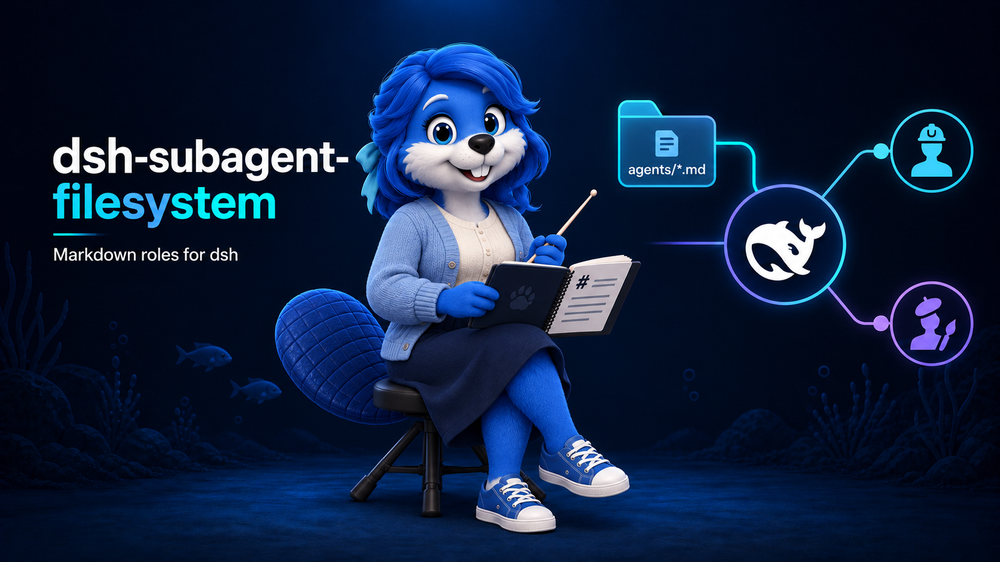

# dsh-subagent-filesystem

Markdown roles for dsh



Discover specialist roles from the agent workspace's `agents/*.md` and expose named delegation tools. Each Markdown body becomes a separate child system section, preserving Harness instructions, the application persona, and native permissions. The delegated task remains user content. Files are read exclusively through the caller's scoped `ctx.fs`, including remote and sandbox providers, with no host-filesystem fallback.

## Install and configure

```sh
dsh plugin --profile my-agent add @amaster.ai/dsh-subagent-filesystem
```

Enable the bundle in the profile's `cordis.patch.yml`:

```yaml
- id: subagent-filesystem
  config:
    enabled: true
    root: agents
```

Disabled by default. `root` defaults to `agents`, relative to the agent's initial workspace directory; sandbox deployments can explicitly select `/agents`. Discovery scans direct `*.md` children only. A missing root produces an empty catalog. Files are loaded when the agent is created; create a new agent to pick up changes. Watching and hot reload are outside the initial scope.

Requires the `fs`, `tools`, `subagents`, `systemPrompt`, and `sessionQuery` services, plus the native in-process provider registered as `spawn`. The standard headless profile supplies these capabilities. DSH peer floor: `>=0.2.1-rc.2`; tested DSH: `0.2.1-rc.5`; tested Cordis: `4.0.5`. This version uses managed activations and requires DSH 0.2.1-rc.2 or newer; use plugin v0.1.27 with DSH 0.2.0.

## Definition format

`agents/inventory-analyst.md`:

```markdown
---
name: inventory-analyst
description: Investigate inventory discrepancies and explain their causes.
---
You are the inventory analyst. Compare posted movements with current balances,
identify discrepancies, and report evidence before recommending changes.
Read references/inventory-rules.md relative to this definition before analysis.
```

Only `name` and `description` are supported in YAML frontmatter. Names must be lowercase kebab-case, start with a letter, and contain at most 55 characters. Description and body must be nonempty. Definitions must be valid UTF-8 and at most 1 MiB. Unsupported fields, duplicate YAML keys, duplicate role names, and tool-name collisions fail that agent's catalog load with a `[dsh-subagent-filesystem]` error. No partial catalog is published; existing application tools are preserved.

`{{…}}` in the body stays literal. Child instructions include the definition's resource directory. The child opens supporting references, scripts, and assets with its own tools, resolving relative paths against that directory. This plugin does not download or execute resources.

## Delegation

The example exposes `subagent_inventory_analyst`; its description tells the parent when to delegate.

| Parameter | Meaning |
| --- | --- |
| `prompt` | Required: a complete, self-contained task delivered as the child's user message |
| `description` | Required: the native subagent's short task label |
| `run_in_background` | Default false: wait for a report; true: return a continuable child id |

Background children use native completion notifications and `send_message` for follow-up. Native subagent services retain model defaults, delegation depth, sandbox boundaries, and approval rules. Definition files cannot override models, tools, or permissions. Foreground failures become tool errors; accepted runs always reach native cleanup.

Named tools belong only to the consuming parent agent. They do not leak into other agents or workspaces, or automatically copy to children. A `subagent-filesystem/role` session event stores the child's role instructions and resource path. Cold restoration reinstalls the original snapshot rather than changing an existing role when its source file changes. Protect these instruction snapshots through the consuming application's existing session storage and access controls.

Unloading cancels outstanding delegations, removes registrations and listeners, and releases background children started by the plugin. Role restoration requires the plugin to remain enabled. The initial version supports native in-process spawn; external ACP/Codex/Claude providers and application configuration downloads are outside its scope.

## Tests

```sh
pnpm --filter @amaster.ai/dsh-subagent-filesystem test
pnpm --filter @amaster.ai/dsh-subagent-filesystem typecheck
pnpm --filter @amaster.ai/dsh-subagent-filesystem build
```

`.github/scripts/integration/dsh-subagent-filesystem.mjs` automatically joins the repository E2E matrix. It installs the packed bundle, starts real dsh, delegates through the integration model, and verifies the actual child system instructions, user task, and resource-file evidence. A local forwarding gateway inspects protocol requests, so system/user separation is verified independently of the model's claims.

Required: `DSH_PKG_TARBALL`, `DSH_INTEGRATION_BASE_URL`, and `DSH_INTEGRATION_API_KEY`. Optional: `DSH_CLI`, `DSH_HOME`, and `DSH_INTEGRATION_MODEL`. For local development, set `DSH_SUBAGENT_E2E_FAKE=1` to use deterministic Messages responses while still running real dsh, native children, and file tools. This mode does not validate real-model behavior.
