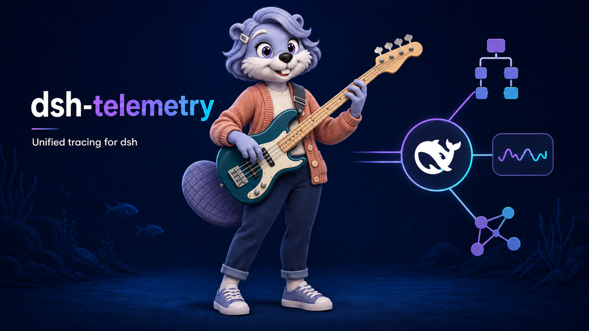

# @amaster.ai/dsh-telemetry

Unified tracing for dsh. One collector creates an isolated OpenTelemetry tree; a Langfuse or Phoenix adapter maps its attributes; one shared OTLP/HTTP **protobuf** pipeline batches, flushes and shuts down exports. No process-global tracer registration and no Langfuse tracing/export SDK required.



## Install

```sh
dsh plugin --profile my-agent add @amaster.ai/dsh-telemetry
dsh plugin --profile my-agent add \
  @opentelemetry/api@1.9.1 \
  @opentelemetry/sdk-trace-node@2.10.0 \
  @opentelemetry/resources@2.10.0 \
  @opentelemetry/exporter-trace-otlp-proto@0.221.0
```

The bundle inserts the `telemetry` row, disabled by default. The SDK-independent collector lives in `core/`. Pure backend mapping/configuration lives in `adapters/phoenix/` and `adapters/langfuse/`; the composition root selects an adapter. The legacy package reuses this collector and the extracted Langfuse context, usage, payload, privacy and media helpers while retaining its SDK reporter. The new plugin has no dependency on the legacy package or Langfuse SDK. dsh service/event consumers are peers, supplied by the profile. The four OTel packages are optional peers and load lazily only when enabled.

## Phoenix

Set environment variables in the dsh process:

```sh
export PHOENIX_COLLECTOR_ENDPOINT=https://phoenix.example.com
export PHOENIX_API_KEY=your-api-key
export PHOENIX_PROJECT_NAME=my-agent
```

Enable through the profile's `cordis.patch.yml`:

```yaml
- id: telemetry
  config:
    enabled: true
    backend: phoenix
    project: my-agent  # optional YAML override
    environment: production
```

YAML `endpoint`, `apiKey` and `project` override environment values. Endpoint defaults to `http://localhost:6006`; `/v1/traces` is appended once, preserving deployment prefixes such as `/s/team`. Authentication sends `Authorization: Bearer <apiKey>`; an empty key supports unauthenticated local Phoenix. Do not use an Arize AX key/endpoint.

Project precedence: YAML `project` → `PHOENIX_PROJECT` → `PHOENIX_PROJECT_NAME` → `default`. The project is sent as the OTel resource attribute `openinference.project.name`. `environment` falls back to `DSH_TELEMETRY_ENVIRONMENT` and is exported as deployment resource/context metadata; Phoenix has no equivalent guaranteed Langfuse environment selector.

## Langfuse

```sh
export LANGFUSE_PUBLIC_KEY=pk-lf-...
export LANGFUSE_SECRET_KEY=sk-lf-...
export LANGFUSE_BASE_URL=https://cloud.langfuse.com
```

```yaml
- id: telemetry
  config:
    enabled: true
    backend: langfuse
    environment: production
```

YAML `publicKey`, `secretKey` and `baseUrl` override the corresponding environment values. An explicit `endpoint` overrides `baseUrl`; the adapter appends `/api/public/otel/v1/traces` unless a complete traces URL was supplied. Authentication uses Basic `publicKey:secretKey`. Langfuse **keys select the project**; `project` does not switch Langfuse projects. Environment falls back to `DSH_TELEMETRY_ENVIRONMENT`, then `LANGFUSE_TRACING_ENVIRONMENT`. Use the environment naming rules of your Langfuse server.

## Observations and request context

Coverage reuses the existing collector: turn roots, LLM generations plus nested `llm-request` spans, tools, hooks, subagents, and native A2A inbox tasks. Session checkpoints flush completed spans; fiber unload closes outstanding work and shuts down the same exporter. Streams and tool results pass through unchanged. Export/init failures log a `[dsh-telemetry]` diagnostic and do not break the agent loop.

```ts
import type { TelemetryTraceContext } from '@amaster.ai/dsh-telemetry';

const context: TelemetryTraceContext = {
  userId: 'user-123',
  tags: ['support'],
  metadata: { requestId: 'req-123', region: 'eu' },
  traceparent: '00-11111111111111111111111111111111-2222222222222222-01',
};
ctx.emit('telemetry/context', sessionId, context);
```

Emit before the next root/turn starts. The collector snapshots strict JSON metadata per session; caller mutations and concurrent sessions do not cross traces. Children inherit request dimensions while runtime metadata wins collisions. An explicit valid W3C parent retains ownership of the external trace name/trace-level IO. Invalid parents start an independent trace. A running A2A task retains its deterministic trace identity; late context is a link. Enable **only one collector per profile** to avoid duplicate observations.

| Observation | Phoenix/OpenInference | Langfuse |
| --- | --- | --- |
| Turn / A2A task | `AGENT` | `SPAN` root, trace/session context |
| Subagent | `AGENT` | `SPAN`, nested under delegation tool |
| LLM | `LLM`, indexed messages/tool calls/model/usage | `GENERATION`, model, disjoint usage buckets |
| Tool | `TOOL` | `TOOL` |
| Hook / raw request | `CHAIN` | `SPAN` |

Phoenix prompt totals include cache buckets; completion totals already include reasoning. Langfuse usage buckets exclude overlapping cache/reasoning counts. Reasoning remains in generation `thinking` output and raw request chunks; Phoenix also gets indexed reasoning text. Parent IDs, clocks and OTel status belong to the shared instrumentation, not adapters.

## Content and media

| Setting | Default | Behavior |
| --- | --- | --- |
| `captureContent` | `true` | `false` suppresses prompt/reply/tool payloads and content-derived status/name details; structural metadata, usage and caller request dimensions remain |
| `maxPayloadBytes` | `262144` | Per captured request, response, tool IO or final adapted attribute, measured as serialized UTF-8 bytes |
| `redactFields` | `[]` | Case-insensitive structured field names, including JSON arguments |
| `captureMedia` | `false` | Opt in to bounded attachment image reads and inline data-URI display |
| `maxMediaBytes` | `5242880` | Image-byte budget per display payload, also subject to the payload cap |
| `mediaTimeoutMs` | `5000` | Abort image reads on timeout/cancellation |

Configured Phoenix and Langfuse credentials, including encoded authorization, are masked again **after adaptation**. Content-disabled mode strips backend-specific IO/indexed-message fields at the final boundary. Payload truncation happens only after atomic redaction. Never put credentials in arbitrary metadata.

Media difference from the legacy SDK: this plugin sends bounded inline image data URIs/metadata through OTLP and does **not** use Langfuse's separate managed-media upload API. Phoenix uses OpenInference image attributes. Backend UI rendering of inline images is server-version dependent; oversized content can become a truncation marker instead of an image. Keep the legacy plugin when managed Langfuse media upload is required. Local tests cover bounded projection and exported image attributes; a green HTTP response alone does not establish UI rendering parity.

Other settings: `traceName` (`dsh-turn`), `userId` (fallback `DSH_TELEMETRY_USER_ID`), `tags` (`[]`), and `release` (fallback `DSH_TELEMETRY_RELEASE`).

## Migration and compatibility

Existing `@amaster.ai/dsh-langfuse` installation, `langfuse` row, Config, environment variables, `langfuse/context`, hook helpers and public exports remain available. Migration is manual: disable the legacy row, enable `telemetry`, select a backend, and emit `telemetry/context`. Existing history is untouched. Metrics/logs/evaluation/prompt management and simultaneous multi-backend export are outside this package.

Tested dependency baseline: dsh `0.2.2-rc.1`, Cordis `4.1.0`, OTel API `1.9.1`, SDK/resources `2.10.0`, protobuf exporter `0.221.0`. Legacy regression also uses Langfuse JS SDK `5.10.1`. Langfuse native OTLP requires server >=`3.22.0`; current upstream v4 documentation is not proof of historical self-hosted compatibility. Phoenix API read-back uses the project spans REST endpoint. Live API validation targets Phoenix `21.0.0` and Langfuse `3.172.1` (reported by the deployed servers). Inline-media UI rendering has not been verified. [Phoenix tracing](https://arize.com/docs/phoenix/tracing/concepts-tracing/how-tracing-works), [OpenInference conventions](https://github.com/Arize-ai/openinference/blob/main/spec/semantic_conventions.md), [Langfuse OTLP](https://langfuse.com/integrations/native/opentelemetry).

CI discovers separate Phoenix and Langfuse base/reasoning, hook, subagent and A2A legs. Each uses a packed bundle, real dsh/model and backend API read-back; missing backend credentials fail instead of substituting a fake backend. Phoenix legs receive only `PHOENIX_API_KEY`, `PHOENIX_COLLECTOR_ENDPOINT`, `PHOENIX_PROJECT_NAME`; Langfuse legs receive only `LANGFUSE_*`. Secret-free `pnpm test:otlp` decodes actual protobuf batches and checks auth, resource, IDs, parenting, timestamps, status and redaction for both adapters through one receiver.
